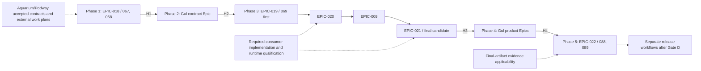

# Dolgorae v0.1.4 release alignment

## Control and authority

| Field | Value |
| --- | --- |
| Role | Shared execution dossier for six adopted roadmap Epics |
| Adopted | 2026-10-10, under Master's approved documentation plan |
| Consumers | EPIC-018, EPIC-019, EPIC-020, EPIC-009, EPIC-021, EPIC-022 |
| Release pair | Dolgorae v0.1.4 and Gul v0.1.0 |
| Lifecycle owner | [Roadmap](../roadmap/README.md); consult it for current execution status |
| Starting provider revision | c1edeb17b9046a75bd8d31f67e9de934d89ed05a |
| Starting Gul revision | 2db9c4f12f88d5ee36810377248efcaf9bf4110c |
| Gul planning revalidation | Current ADR-0057 maps Phase 2 to E15/T21 and Phase 4 to E16-T1..T16; original E15-T5..T20 remain Historical/Retired with complete scope mapping |
| Release consumers | Aquarium, Podway and Gul; the complete three-consumer acceptance matrix is mandatory |
| Current contract state | Checked public-v2 and Gul consumer-v2 contracts are bound by the immutable H1 lock; production implementation and final consumer acceptance remain pending |
| Execution authority | Initial adoption authorized documentation only; later execution requires its separately approved envelope. Implementation, reviews, runtime use, commits and publication retain their separate boundaries |

The [documentation authority map](../README.md) governs this dossier. It owns
the execution requirements and handoff map for the adopted work. Observable
behavior belongs in [specifications](../specs/README.md), component and state
ownership in [architecture](../architecture/README.md), rationale in
[ADRs](../architecture-decision-records/README.md), and checked shapes in
[protocol](../protocol/). TASK-067 and TASK-068 reconcile and publish those
owners before source implementation. Existing public-v1 semantics remain
version-qualified authorities during that work.

The two advisory reviews use CD, GI and EN identifiers. Their proposed later
release dates and their recommendation to move EPIC-009 are superseded by the
approved scope here. Verify their diagnoses and measure the estimated costs
before closing work. Execute from the adopted requirements here without
depending on disposable review files or a local handoff copy.

## Approved outcome and boundaries

Ship the corrections and engine capabilities with the complete EPIC-009
collaboration boundary and all mandatory Aquarium, Podway and Gul expectations.
Use five whole-Epic phases and four Dolgorae/Gul handoffs. Publish the qualified
contract, let Gul close its contract/foundation Epic, then record Gate A and
complete provider implementation. Gul closes its product/qualification Epics
against the fixed candidate before Dolgorae independently qualifies the final
combination. Neither release publishes before all three consumers and both
products' final QA pass. Provider-only tests cannot establish actual Gul acceptance.

Dolgorae remains the durable operational owner of Runs, authorization,
accepted instructions/tasks, execution identity, results and recovery. The
Primary or Aquarium Judge owns semantic judgment and final acceptance.
Deterministic finding aggregation may preserve conflicts; it cannot adjudicate
them or silently call a model.

Codex app-server remains the executor. Codex and Claude may host an external
Primary that calls the trusted facade; a Claude executor is not introduced.
Parallel writable workers and code integration remain outside this release.
One writer per canonical workspace and one active Turn per Run remain required.

Internal Specialists may collaborate through EPIC-009. External Engagements
gain assignment queueing, reuse, groups and activation under their external
Primary; they do not gain Specialist-to-Specialist lateral messaging.

Public v2 serves modern caller-workspace Runs and Markdown Roles. Existing
accepted public-v1 records retain their bytes, identities and supported
inspection, result collection, closure and recovery. Do not restore new JSON
Role authoring as Gul's provisioning strategy or remove readers simply because
their schema number is old.

Podway retains its own single outer cursor, structural receipt and progression
authority. Dolgorae exports executor evidence; it neither mutates Podway state
nor treats a group as one Podway Action without that owner's mapping decision.
Aquarium backend selection and host qualification remain Aquarium-owned.
Mandatory compatibility and runtime acceptance remain release prerequisites;
they cannot be relabeled optional activation or a documentation handoff.

No provider downgrade guarantee is added. Both products must pass the agreed
pre-release tests. Existing consumer backup and recovery obligations still
apply, but do not substitute for candidate qualification.

## Requirement owners and publication order

| Concern | Existing owner to consume | Required adoption |
| --- | --- | --- |
| Modern sources, access and migration | [Caller-workspace contract](../specs/caller-workspaces-v1.md) | Version explicit dependencies, project guidance, fixed read-only pooling and public projection before changing admission |
| Consumer behavior and release boundaries | [Gul consumer v1](../specs/gul-consumer-v1.md) and product specification | Add consumer v2 and the isolated unpublished-candidate qualification path; preserve v0.1.3 history |
| Operational and semantic ownership | Product specification and architecture | Keep Controller, Broker, Primary/Judge and external Primary responsibilities separate |
| Process identity and exact-build control | Architecture and ADR-011 | Preserve mutation refusal; extend supported recovery and generation handoff |
| External MCP invocation identity | Architecture, ADR-031 and the historical checked MCP disposition | Qualify version-pinned Codex and Claude host routes before contract freeze; explicitly adopt any successor authority/carrier decision |
| Persistence and capacity | Architecture, ledger and Profile protocol owners | Define versioned checkpoints, compaction, crash ordering and operator authority |
| Wire and machine contracts | Protocol directory | Publish v2 and needed successors alongside frozen v1; no reinterpretation of old fields |
| Release order and task membership | Roadmap | Require the exact joint candidate pair before publication; no lifecycle claim from an artifact |
| Installation and recovery | [Operations](../ops/README.md) | Document supported Role/policy setup, capacity maintenance, typed blockers and cleanup |
| Toolchain and QA | [Implementation tips](../implementation-tips/README.md) | Document protoc, CI, exact candidate verification and separately authorized runtime checks |
| Three-consumer release acceptance | [Consumer acceptance specification](../specs/dolgorae-consumer-acceptance-v014.md) | Pin current Aquarium/Podway/Gul authorities, implementing Tasks, external prerequisites, runtime evidence and final gates |

TASK-067 adopts the complete behavioral and architectural decisions, including
bounds and failure states. TASK-068 publishes their executable shapes and
known-answer fixtures and the qualified immutable three-consumer package.
EPIC-018 closes at TASK-068. TASK-069 moves to the beginning of EPIC-019 and
records Gate A from Gul's completed contract/foundation Epic. A semantic gap
cannot be filled by guessing a field in one repository.
After agreement, a semantic change requires a revised canonical package and
consumer acknowledgement.

## Pre-contract external MCP host feasibility

TASK-067 owns the host feasibility decision; TASK-068 requires its qualification
before freezing the successor package. Gate A cannot pass with this decision
unresolved. TASK-077 implements and requalifies the selected route later.

The checked
[external review MCP disposition](../protocol/dolgorae-specialist-review-mcp-disposition-v1.json)
records Codex CLI 0.149.0 as mcp_unavailable because the required host-controlled
externalRequestRef was absent. Preserve that historical record and the separate
SR1 Machine CLI carrier. It establishes neither support nor impossibility for
a newer host or the External Specialist successor.

Reconcile the decision with
[ADR-031](../architecture-decision-records/README.md#adr-031-use-explicit-per-request-mcp-metadata-for-external-review-idempotency).
Its authority boundary keeps logical invocation identity outside model control.
Explicit facade idempotency arguments alone do not establish that boundary.
Connection identity, stdio process identity, JSON-RPC request ID and text equality
cannot identify a durable invocation.

| Required host | Supported version and route | Current decision |
| --- | --- | --- |
| Codex host | Codex CLI 0.160.0 with the Dolgorae-owned pre-dispatch hook and native call/thread metadata binding | Bounded prototype feasibility independently accepted and bound by the H1 lock; the 0.149.0 record remains historical negative evidence |
| Claude host | Claude Code 2.1.295 with the Dolgorae-owned pre-dispatch hook and protected opaque binding | Bounded prototype feasibility independently accepted and bound by the H1 lock; protected native hook journal is part of identity state |

For each route, TASK-067 names the trusted owner that creates the logical
invocation identity before first delivery and durably retains it with the
accepted input digest and receipt/lookup linkage. Define retention, concurrent
admission, crash ordering and ownership checks. A deliberate new invocation
with identical arguments gets a new identity; retries of one invocation retain
the original identity. Ambiguous delivery must not generate a replacement key.

If the route requires a host adapter or receipt-and-lookup protocol, name its
maintainer and installation/configuration owner, protected persisted-state
owner and schema, credential carrier, restart/reconnect recovery, and failure
behavior. Define lookup scope and authoritative absence. Missing or corrupted
identity state and lookup failure retain uncertainty or refuse before effects;
they do not authorize a new execution. Publish the chosen boundary in the
specification, architecture, ADR and operations owners before checked shapes.
An alternative to ADR-031's metadata carrier needs an explicit successor
decision and qualification; this dossier does not silently accept one.

Qualify the following matrix on both exact host/adapter versions. Record
scenario outcomes and the tested identity/receipt rules without retaining
credentials or raw model traffic:

| Scenario | Required acceptance |
| --- | --- |
| Initial invocation | Trusted owner creates and persists one identity before delivery; one acceptance is linked to it |
| Exact replay | Same identity and input return the original acceptance/receipt without duplicate execution |
| Changed-input conflict | Same identity with different accepted input is rejected as a conflict without a second effect |
| Concurrent invocations | Concurrent replay admits once; deliberately distinct invocations with identical arguments remain distinct |
| Reconnect | Recovered transport uses the retained identity and resolves the same receipt/unknown state |
| MCP process restart | Replacement process recovers the trusted binding; process lifetime never supplies continuity |
| Response loss around acceptance | Loss before acceptance, after acceptance but before acknowledgement, and after receipt commit resolve through the same identity and authorized lookup; unresolved effects are never redispatched |

Runtime execution of this pre-contract matrix needs separate authorization and
documented opt-in. Static fixtures alone cannot establish host feasibility.
The [selected qualification boundary](../specs/dolgorae-v014-host-contract-qualification.md)
defines exact executable pins, tested layers, physical host-loss recovery and
reproduction. Both actual candidates passed those prototype scenarios and their
bounded feasibility was independently accepted; the coordination decision settles consumer source
selection and implementation/acceptance ownership. Until both mandatory host
routes and their authority rules are accepted, TASK-068
contract freeze, TASK-069/Gate A, TASK-077 acceptance and dependent sequential
work cannot advance. A typed unsupported response can verify
failure handling, but cannot pass mandatory host-support acceptance or reduce
the approved release scope. No Task is marked BLOCKED or complete by this plan.

## Execution order and dependencies

### Five phases and four handoffs

| Phase | Whole-Epic execution | Entry and closeout | Boundary output |
| --- | --- | --- | --- |
| 1: Dolgorae contract | EPIC-018: TASK-067, TASK-068 | After completed EPIC-017; qualify both required host mechanisms, pin all consumer requirements/owners and publish checked package. Close without Gul's subsequent Epic or TASK-069 | H1: qualified immutable contract package and acceptance matrix to Gul |
| 2: Gul foundation | Gul E15 contract/foundation Epic containing permanent E15-T21 and required closeout | Consume H1; complete pin validation, corrections, scenario ownership and scoped foundation checks. Neither entry nor closeout requires TASK-069 | H2: completed consumer Epic result, validated pin and evidence to Dolgorae |
| 3: Dolgorae implementation | EPIC-019: TASK-069, TASK-070..075; EPIC-020: TASK-076..079; EPIC-009: TASK-080..083, TASK-027; EPIC-021: TASK-084..087 | TASK-069 consumes H2/Gate A. Execute and close the four separate Epics in order. Required Aquarium/Podway implementation and runtime qualification are explicit prerequisites of their named Tasks; TASK-087 qualifies the post-cleanup intended-version artifact | H3: fixed runnable Dolgorae candidate and applicable consumer evidence to Gul |
| 4: Gul product | Gul E16 product/qualification Epic: E16-T1..T16 inherit the complete historical E15-T5..T20 scope | Use completed provider capabilities and H3 throughout; build intended Gul v0.1.0 artifact, run own complete QA/native campaign, real-account smoke, devices/soak and final recovery rehearsal. Close on own complete acceptance without TASK-088/089 | H4: completed Gul artifact and reproducible qualification evidence to Dolgorae |
| 5: Dolgorae final | EPIC-022: TASK-088, TASK-089 | Consume H4; independently reproduce required actual-client/provider cases and verify/revalidate Aquarium/Podway evidence against unchanged H3. Consume the complete accepted three-consumer matrix, repository gates/final QA and exact provenance | Gate D handoff to separate release workflows; no automatic publication |

Each epic-handler receives one Epic and retains the shared dossier. Dolgorae
keeps one active Epic and one active Task. A blocked prerequisite occupies its
normal slot; later work cannot bypass it. Whole-Epic closeout, supported runtime
acceptance, Git/publication and consumer activation remain separate authorities.

The four handoffs count Dolgorae/Gul switching only. Necessary Aquarium/Podway
owner work is explicitly scheduled by TASK-067 in the
[external prerequisite register](../specs/dolgorae-consumer-acceptance-v014.md#external-implementation-and-decisions).
Those teams own their implementation and qualification. The five phases do not
make that work disappear or permit undocumented extra consumer dependencies.

### Phase-boundary artifact and evidence requirements

| Handoff | Required artifact and evidence | Acceptance responsibility |
| --- | --- | --- |
| H1: Phase 1 to 2 | Canonical requirements; exact contract-source/schema/descriptor revisions and digests, generated surfaces, policies/error/effect/bounds, known answers and immutable lock; two-host feasibility result and tested host/adapter versions; immutable three-consumer requirements matrix, named owners/scenarios and accepted external work plans; later runtime-record contents/owners/handoffs, with future final implementation/artifact pins explicitly pending | Gul validates the package and closes its contract/foundation Epic; Dolgorae EPIC-018 already closed. H1 requires no final artifact scheduled for later phases |
| H2: Phase 2 to 3 | Consumer Epic closeout, exact validated package pin, completed T21 corrections/foundation checks, scenario/harness ownership, retained runtime obligations assigned to product Epics | TASK-069 validates complete output and records Gate A; partial active-Task acknowledgement is insufficient |
| H3: Phase 3 to 4 | Intended v0.1.4 artifact prepared after relevant packaging; source revision and binary/package checksums; actual Aquarium/Podway consumer and adapter implementation revisions/artifact identities used for qualification; immutable H1 contract/manifest digests, applicable host/runtime/adapter pins and relevant configuration; runnable setup/harness instructions; required repository gate and applicable Aquarium/Podway actual-path evidence after TASK-087 | Gul admits this exact isolated candidate for all product Epics; no unqualified rebuild or silent runtime/configuration change |
| H4: Phase 4 to 5 | Final Gul implementation revision and intended v0.1.0 artifact/package checksums bound to unchanged H3 and immutable H1; product Epic closeout and own gates/QA; reproducible actual-client native faults/load/latency/recovery, separately authorized real-account functionality, devices/soak and final packaging/recovery results | TASK-088 independently verifies H3/H4 against H1 and reproduces necessary cases; TASK-089 consumes all accepted consumer rows and final provenance |

H1 freezes contract requirements and the owners/contents/delivery points of later
qualification records, not future final consumer artifacts. H3/H4 record those
runtime bindings separately against H1's package identity. Binding a completed
implementation to unchanged H1 does not require republication. Changed agreed
semantics, limits, compatibility or required host/transport assumptions still
require correction/republication/acknowledgement; candidate changes still require
impact assessment and affected requalification across all three consumers.

Handoffs include bounded scenario/result/limit and applicability records, not raw
logs or provider prose. When reviewed structured evidence must persist across
repositories, use the approved aquarium.promoted-evidence/v1 package policy;
never promote credentials, raw reports or runtime identities. Publication of a
consumer's qualification evidence is not product release publication.

The current Gul ADR-0057 and canonical roadmap adopt E15 for Phase 2 and E16
for Phase 4. E15 is completed with retained E15-T1..T4 and permanent E15-T21. Historical
E15-T5..T20 are Retired with scope mappings to Planned E16-T1..T16; this
amendment preserves both historical IDs and new accepted owners. Gul owns its
Task identities/statuses. References to old T5..T20 scope below describe the
preserved requirements, not executable historical Tasks. E16-T3 owns the native
harness, E16-T5 the early packaging rehearsal, E16-T6 isolated test-mode use and
E16-T16 the final campaign/real-account/device/soak evidence.

E15 closes on completed pin validation, foundation corrections and scoped
verification, without TASK-069 or Phase 3 provider implementation. Required
provider-dependent native cases belong to E16 and remain mandatory; fixtures
establish only their designated foundation scope. If a foundation acceptance
still requires unavailable provider runtime, explicitly correct the verification
allocation without dropping the obligation or falsely completing E15.

Preserve Gul's accepted CAS/draft versions, conditional cleanup, immutable
unresolved material and shared attachments; foreground allocation/fairness for
six streams; bounded actor reads over accumulated closed history; append-only
migration after migration 13; native harness opt-in; and isolated rehearsal
separate from production cutover after final product closeout/Gate D. H2 is completed in Gul; the [Gate A acceptance](../specs/dolgorae-v014-gate-a-acceptance.md)
records Dolgorae's independent assessment. H4 and actual runtime evidence remain pending.

Each handler receives exactly one Epic and this shared dossier. Preserve
completed predecessor history. Use the repository Task and Epic acceptance
rules, the selected authorized review route and normal commit boundaries.
Document adoption alone starts no Podway session, provider call or Codex goal.

## Feedback-to-work map

Every row must end with a verified fix, a specification correction, or an
evidence-backed invalid/non-applicable finding. Estimates require measurement.
Current acceptance failures cannot be closed by moving them to future work.

| Feedback | Primary Task owner | Adopted action and verification |
| --- | --- | --- |
| CD-01 | TASK-071 | Keep exact-build mutation identity; add typed blockers and safe quiescent handoff; test rebuild while idle and busy |
| CD-02 | TASK-075 | Reuse executable/schema observation with config and file invalidation; count probes across starts and profile reads |
| CD-03 | TASK-075 | Reuse own executing-build evidence correctly and replace 25 ms repeated observation with bounded durable waits |
| CD-04 | TASK-072 | Capacity errors, terminal/lifecycle reserve, segments/checkpoints and recoverable maintenance |
| CD-05 | TASK-073 | Profile journal compaction, capacity versus corruption, durable cleanup failure and crash-safe reduced writes |
| CD-06 | TASK-074 | Contain worker-thread failure; test durable intent and recovery when journal state is poisoned |
| CD-07 | TASK-075 | Database fast path, useful indexes, content deduplication and explicit result retention/GC |
| CD-08 | TASK-075 | Cache Git availability and workspace observation with identity invalidation; steady calls spawn no Git |
| CD-09 | TASK-067, TASK-078 | Modern public contract and mixed-manifest coexistence; retain accepted legacy meanings |
| CD-10 | TASK-076 | Capture selected guidance explicitly; preserve deliberate project discovery suppression |
| CD-11 | TASK-078 | Qualified read-only pool, sixth-generation warning, configured cap and member subagent policy |
| CD-12 | TASK-087 | Consumer inventory and migration precede justified retirement; preserve required frozen regression |
| CD-13 | TASK-087 | Recursive architecture guards and component splits alongside affected changes; no blanket helper deduplication |
| CD-14 | TASK-067, TASK-087, TASK-089 | Build identity, protoc, CI, consumer qualification and exact release-artifact provenance |
| GI-01 | TASK-071 | Active close ownership, retained cause, current revision, resumed recovery and typed actions |
| GI-02 | TASK-079 | Known unsupported interactions produce safe opened/resolved timeline items; existing history reads without data rewrite |
| GI-03 | TASK-078 | Modern Runs cannot break v1 listing or shared writer status; v2 projects modern Runs directly |
| GI-04 | TASK-078 | Fresh modern policy/Role provisioning and Profile rebinding through the supported modern path |
| GI-05 | TASK-070 | Definitive refusal releases intent durably; original-key retry admits once across restarts |
| GI-06 | TASK-075 | Ledger tailing, idle wake/backoff and separate stream work budgets |
| GI-07 | TASK-075 | Cheap observation and shared sampling; keep fresh safety proof on mutation boundaries |
| GI-08 | TASK-075 | Profile lookup reuses checked executable/schema observation without stale configuration |
| GI-09 | TASK-068, TASK-070 | Per-method effect/classification, writer holder and response-loss lookup |
| GI-10 | TASK-079 | Produce redacted command, completion, workspace-change and runtime-error events |
| GI-11 | TASK-079 | Versioned permission/MCP decision schemas and answer-owner routing; old unsupported records stay readable |
| GI-12 | TASK-071, TASK-075 | Typed build blockers, bounded server work and safe RPC/lifecycle diagnostics |
| GI-13 | TASK-070 | Authorized lookup does not depend on attachment paths or current request reconstruction |
| GI-14 | TASK-068, TASK-075 | Forward/tail paging, encoded byte budgets and complete artifact-backed large content |
| GI-15 | TASK-087, TASK-089 | Distinct development identity and exact intended release version on tested artifacts |
| GI-16 | TASK-075, TASK-078 | Reuse aggregate reads and derive availability from source evidence |
| EN-A1 | TASK-076 | Authoritative accepted identity, complete result digest, rounds, disposition and lookup |
| EN-A2 | TASK-076 | Inline Role with captured dependencies under explicit bounded source rules |
| EN-A3 | TASK-067, TASK-068, TASK-077 | Decide and qualify both trusted host routes before freeze; implement stdio MCP with durable invocation identity and protected credentials |
| EN-A4 | TASK-077, TASK-086 | Versioned Podway adapter export and known-answer qualification |
| EN-A5 | TASK-076 | Selected project guidance captured and included in instruction identity |
| EN-A6 | TASK-079 | Typed bounded decline/interrupt when no Controller can answer |
| EN-B1 | TASK-084 | Checked structured findings with evidence, coverage and limitations |
| EN-B2 | TASK-084 | Durable group assignment, any/all/k wait and collection |
| EN-B3 | TASK-085 | Deterministic provenance-preserving merge, conflicts, gaps and algorithm identity |
| EN-B4 | TASK-085, TASK-086 | Explicit synthesis task; qualify receipt scope without inventing Podway group support |
| EN-C1 | TASK-072, TASK-073, TASK-075 | Capacity and observation prerequisites before larger fan-out |
| EN-C2 | TASK-078 | Configured K servers serve fixed read-only members; isolation and native-subagent suppression are qualified |
| EN-C3 | TASK-080, TASK-082 | Queue, reuse, deadlines, passivation and activation also serve external assignments |
| EN-C4 | TASK-081, TASK-083, TASK-027 | Keep and complete internal lateral messaging, wait graph and cycle rules in v0.1.4 |
| EN-D | TASK-079 | Controller-owned command, permission and MCP approval or explicit policy decline |

G4-1 through G4-7 are Gul-owned corrections. Their provider dependencies are
TASK-068/070/071/075/078/079. H1 supplies the correction requirements;
Gul's Phase 2 Epic completes the T21 foundation scope. TASK-069 consumes only
the completed H2 result; TASK-088 independently verifies the Phase 4 corrected
consumer behavior. Partial-Task acknowledgement is no longer the normal path.
Gul has separated T10's isolated test-mode use from production cutover after
T20, Epic closeout and Gate D. Preserve these newer planning decisions.
Do not mutate Gul from a Dolgorae Epic handler.

## Corrections to the advisory diagnosis

Exact executable pinning is an accepted safety boundary with frozen control
v1 inspection/shutdown. Its ordinary-call refusal is not proof that every
record is unusable or that no recovery path exists. Test the real handoff and
close failure paths; preserve cross-build mutation refusal.

Project and ancestor AGENTS suppression is required by the caller-workspace
contract. Explicit task context already permits guidance. TASK-076 adds
captured, reusable guidance and dependencies without re-enabling ambient
discovery or granting authority through text.

A display cache cannot authorize writer release or generation replacement.
The five-sample process and history proofs remain fresh at those boundaries.
TASK-075 separates the cost of display observation from mutation proof before
claiming the warm 50 ms target.

Current Aquarium documents record exercised Codex native delegation and
isolated Podway acceptance. They do not establish complete host qualification,
but they invalidate the claim that an absent raw digest field necessarily
blocks all native delegation. Refresh the actual mapping before requesting a
backend change; no automatic Dolgorae reactivation is part of this work.

The initial Gul review treated T4 as staged. The starting Gul revision has T4
Completed. The newer ADR-0057 planning tree retains E15-T21 Planned for foundation
corrections and maps retired E15-T5..T20 scope to Planned E16-T1..T16.
Execution remains stopped. E15-T21 owns G4 correction against committed T4;
registration is not implemented-fix evidence. Preserve both completed history
and the current consumer roadmap authority.

CPU percentages, resident memory, fsync counts, storage duplication and the
percentage of legacy code were not measured by these reviews. Reproduce the
mechanism, measure the current implementation and attach an outcome to its
Task. A large file or repeated helper name alone does not justify a refactor.

## Consumer contract requirements

### Entry, identity and capabilities

Public v2 uses modern Run and Session creation with explicit workspace identity,
Controller carrier, Profile, Role/configuration, requested access, lane,
assurance and idempotency. Gul's can-edit mode selects a dedicated lane.
A fixed read-only pooled Run cannot become writable. A dedicated Run may use
the already qualified same-thread authorized transition.

Gul's creation-time mode is a user choice. Store observed effective access and
verification separately. Neither a threadless start nor temporarily released
writer authority changes that choice.

GetCapabilities remains the admission surface. The agreed package defines v2
negotiation, required method subset, credential identity, bounds and descriptor
digest. A server-instance change requires renegotiation. Runtime advertisement
follows implemented and qualified capability, never a schema's existence.
Development candidates are admitted only through the agreed isolated test
profile; production admission identifies the released v0.1.4 artifact.

### Submission, lookup and errors

TASK-070's [durable Submit specification](../specs/dolgorae-v014-durable-operations.md)
owns retained native identity, synced definitive refusal and Controller-scoped
lookup. Its native diagnostic precedes TASK-078's public-v2 projection; the
later consumer qualification and H3 requirements remain in force.

Preserve durable intent before effect and receipt before acknowledgement.
A definitive upstream refusal resolves the reservation durably. A same-key
retry may then execute once; an accepted same-key replay returns its retained
receipt. Text equality does not identify an attempt.

An authorized operation lookup returns a retained receipt, a definitive
non-acceptance resolution, an unresolved effect, or authoritative absence.
Its scope includes Controller ownership and operation kind. TASK-068 freezes
the exact availability and classification rules; absence is meaningful only
under that authoritative scope. Lookup never rereads images or changes work.

Keep classification separate from effect: Rejected, RetrySameKey, Unknown and
RecoveryNeeded. Rejected applies to the current request; it does not prove an
earlier ambiguous request failed. Missing/unrecognized details and potentially
post-effect internal errors remain uncertain. A deadline cannot erase a durable
admission or authorize redispatch.

### Close and recovery

TASK-071's [retained Close and build recovery specification](../specs/dolgorae-v014-close-recovery.md)
owns the native lifecycle lock, observed-owner proof, preserved failure cause
and typed executable-handoff blockers. Public-v2 projection remains TASK-078;
this correction does not advance the full Phase 3/H3 or Gul E16 prerequisites.

One durable close operation rejects new work and settles its owned aggregate.
Use the current Primary revision after settlement. Persist causes and actionable
recovery; SETTLING denotes a live advancing owner, not a stalled record.
Gateway restart resumes the operation. Recover/Reconcile first address the
actual Primary admission/process/outcome issue and then continue the same close.

Interrupt acknowledgement is not terminal proof. Busy or unknown generations
cannot be silently replaced. An idle build handoff requires no active turn or
interaction, writer settlement, exact old-generation absence and retained
history/instruction identity. Keep frozen cross-version control small.

### Timeline, events and content

Provide forward and latest-page access with explicit continuation cursors,
stable captured head, chronological items within a page and encoded byte bounds.
Cursors are opaque; clients do not compute head-minus-k. Publish a 4 MiB
response budget for normal timeline pages and artifact references for content
that cannot fit, with compatible client/server receive limits and no stuck
one-item page. Preserve all original readable bytes through chunk/digest checks.

Heartbeat head is advisory and may include filtered records. It updates
liveness without advancing the delivery cursor or proving a gap. Event refresh
masks distinguish Run, writer, interaction, timeline, usage and aggregate reads.
Commit ingest progress per page; isolate timeline degradation from session
snapshot and approval availability.

OPERATIONAL produces safe command start/completion, workspace changes and
runtime errors. Define the safe command/path projection and secret canaries
before retaining it; never publish raw arguments by assumption. MINIMAL and
historical stamped projections retain their meaning. Usage semantics, stream
pressure/end/resume behavior and final response availability are frozen in
TASK-068 fixtures.

### Interactions and results

Permission and MCP elicitation requests receive typed schemas and allowed
decisions. Protect answer content and validate the current Controller, request,
Run/Turn and generation at response. Route delegated requests to their declared
answer owner; no owner produces a bounded explicit decline or interruption
with a durable safe cause, including SPECIALIST_INTERACTION_UNSUPPORTED
when no supported answer path exists.

Existing resolved unsupported_request records remain valid readable history,
including their opened and resolved items. Unsupported runtime variants fail
with a typed visible refusal; they do not become fabricated approval cards.

Gul discovers individual and merged results through supported listing and
artifact metadata/chunks. A summary, preview or artifact ID does not prove the
complete result digest. Reader authorization, bounds and integrity remain
checked. Failed/expired/unknown sources remain part of group coverage.

## Engine and persistence requirements

### Captured instruction and receipt identity

Capture exact accepted Role body, named dependency bytes, selected guidance and
Agent Configuration before allocation/dispatch. Preserve UTF-8 bytes, lengths
and digests without trimming or Unicode/newline normalization. Reject unsafe,
raced and over-budget sources. Keep Profile ambient guidance separately
disclosed and preserve the existing captured-source ceiling unless TASK-067
adopts a justified successor bound.

Publish dolgorae.delegation-identity/v1 through facade hire, assign and collect,
Broker results and authorized read-by-key lookup. Every digest gets a
versioned byte definition: included/excluded fields,
canonicalization, encoding, domain separation and representation. Request
envelope identity, accepted task identity, instruction identity and full result
identity are distinct. TASK-068 publishes known-answer vectors.

Count accepted executor assignments once within a recorded caller scope;
include uncertain dispatches conservatively, exclude proved non-dispatch, and
do not count replay or collection. Prove idle/released disposition from current
membership and workload evidence. A running or unresolved member cannot be
exported as idle.

The facade and Broker expose the same facts through their appropriate
authorization boundaries. Keep Podway's existing role/configuration/task/result
and 1..32 round requirements; map its exact idle/released vocabulary. A
retained member alone does not establish idle. Adapter IDs/version and scope
definitions belong in the published mapping, not inferred field-name matches.

### Findings, groups and synthesis

structured_findings_v1 binds a stable finding key, claim, kind, stance,
confidence, pinned evidence references, covered questions and limitations.
Evidence identifies a commit/blob and path/range, Git object, accepted context
or URL. Validation precedes result publication; invalid output yields
FINDINGS_OUTPUT_INVALID.

A group has an immutable accepted assignment manifest and bounded tasks.
assign_group, await_group(any/all/k) and collect_group recover by identity and
include terminal failure and unknown states. Waiting does not cancel execution.
The scheduler keeps one target Turn; larger groups may queue on bounded members.

merge_group_results publishes dolgorae.merged-findings/v1 and makes no model
call. It groups exact finding keys, removes
only equivalent entries, preserves per-source task/member/Role/result identity,
lists explicit conflict sets, coverage and missing sources, and hashes sorted
inputs with the algorithm version. Free-text similarity cannot silently collapse
different claims. An optional synthesis task is explicitly assigned, consumes
the merged artifact and adds its own accepted round/result evidence.

A group remains a Dolgorae runtime operation. Podway's current contract does
not promise fan-out, child Actions or a group receipt. TASK-086 records its
owner's mapping decision before claiming a single Action receipt; individual
exports and full group provenance remain testable without that claim.

### Pool, queues and process ownership

Pool only fixed read-only members with compatible accepted Profile and
process-static configuration. Configure K and a dedicated-generation cap in
TASK-067; freeze typed capacity errors and the sixth-generation warning.
Disable native subagents by default for Specialists. A member explicitly
requiring qualified native subagents uses an eligible dedicated configuration.

Pool leases cannot transfer writer authority, mix accounts/configurations,
or make one member's passivation stop another. Shared-server shutdown needs
proof for the whole owned generation. Quiescence of one thread is not that proof.
Requalify instruction suppression, tool binding and read-only enforcement on
the pooled lane before advertising it.

Queues retain accepted task bodies, deadlines and source identity. Use the
existing collaboration-policy defaults for priority, aging, fairness, bounded
waits and queue/backpressure unless TASK-067 adopts an explicit successor.
Lease expiry applies before authoritative Turn acceptance, not to running or
unknown work. Activation crash recovery never redispatches uncertain work.

### Capacity, corruption and retention

Reserve capacity for accepted work's finalization and lifecycle cleanup before
admitting more work. Separate predictable capacity refusal from integrity
failure. Specify segment/checkpoint selection, durable watermark, hash continuity,
recovery and reader compatibility before changing the persisted contract.

TASK-067 defines maintenance locking, concurrent-reader generation selection,
over-cap recovery admission and interrupted-maintenance recovery. Maintenance
never changes accepted identity bytes or bypasses a live writer.
TASK-072's [native ledger maintenance contract](../specs/dolgorae-v014-ledger-maintenance.md)
implements workspace-scoped retained plans and per-Run checkpoint selection.
It reserves accepted finalization and each pending interaction's cleanup,
preserves original chain/receipt/export bytes, and keeps old reader and recovery
references without automatic pruning. Public-v2/facade activation remains
TASK-078; actual consumer qualification and the complete Phase 3/H3 prerequisites
retain their owners. EPIC-019 alone does not unlock Gul E16.

Membership compaction preserves active/unknown members, Profile binding
identity and audit continuity across every crash boundary. Release failure
requires visible cleanup/recovery, even if the underlying close already
succeeded; never retract its retained success receipt.

Store complete result bytes once with immutable digest references. Retention
and GC are explicit operator operations with dry-run scope, ownership checks,
protected active references and documented unavailable-result behavior.
Automatic deletion is not enabled by this dossier. Keep accepted identities
and auditability when explicitly retiring result content.

## Verification and rendezvous

### Cross-repository dependencies

| Rendezvous | Entry prerequisite | Participation and output |
| --- | --- | --- |
| H1 contract publication | Completed EPIC-018 and its two Tasks; qualified host feasibility and pinned three-consumer matrix | Gul starts its whole contract/foundation Epic. EPIC-018 does not wait for TASK-069 or Gul closeout |
| H2 / Gate A | Gul contract/foundation Epic completed with validated pin, all T21 corrections and scoped closeout evidence | TASK-069, first in EPIC-019, accepts the output. Gul's contract Epic does not wait for TASK-069 |
| H3 provider candidate | EPIC-019, EPIC-020, EPIC-009 and EPIC-021 closed in order, including required Aquarium/Podway implementation/qualification and post-cleanup candidate | Gul starts its whole product Epics using the fixed artifact; all early/native/recovery rehearsals occur within Phase 4 without a Dolgorae Task rendezvous |
| H4 / Gate C producer result | Gul final product Epic closed with exact intended artifact and complete own campaign, QA, real-account, device/soak evidence | EPIC-022 starts afterward. Neither TASK-088 nor TASK-089 completion is required for Gul Epic closeout |
| Gate C independent acceptance / Gate D | TASK-088 substantively verifies H4 and all three consumers on final artifacts | TASK-089 consumes completed three-consumer matrix, required gates/final QA and provenance for release handoff |

### Gate A: contract agreement

The [current Gate A acceptance](../specs/dolgorae-v014-gate-a-acceptance.md)
consumes completed Gul E15/H2 without changing the immutable H1 snapshot.
The roadmap owns TASK-069's review and completion state.

In Phase 3, TASK-069 requires both owners to acknowledge one immutable package: canonical
requirements, source/descriptor, generated clients, policies, error table,
schemas, fixtures, known-answer digests and scenario ownership. Record its
revision and digests, including the pre-contract host feasibility decision and
qualified host/adapter versions and Aquarium/Podway requirement mappings.
TASK-069 consumes H2 from the completed Gul contract/foundation Epic, including
completed T21 corrections, validated package pin and scoped acceptance evidence.
API additions, changed meanings or changed limits require a new package and
acknowledgement through explicitly scheduled correction work. Phase 3 then
completes the provider Epics before Gul product implementation in Phase 4.
Gate A is neither an EPIC-018 completion condition nor a reason to keep Gul's
contract Epic active. Required consumer implementation is tracked independently
in its owner and must complete before dependent Phase 3 acceptance.

### Gate B: early native smoke

During Phase 4, after H3 and Gul's corresponding create/send/approve/close
slice are runnable, Gul exercises them in isolated homes/workspaces.
Test the real Gul adapter and real Dolgorae gateway with the pinned native
Codex app-server backed by scripted loopback Responses. Cover initial write,
permission/MCP handling, refusal and
same-key lookup, consented close and reconnect. This is Gul-owned early feedback
inside its product Epic sequence, not an additional Dolgorae/Gul handoff or a
concurrently active provider Task. It does not complete TASK-088 or permit
production cutover. A discovered provider defect records a blocker and an
explicit correction/requalification schedule.

### Gate C: complete joint candidate E2E

Gate C has two required sequential results. Phase 4 completes Gul's own campaign
and product Epic closeout, then H4 carries reproducible evidence and the final
Gul artifact. Phase 5 TASK-088 independently validates that evidence, executes
the completed artifacts to reproduce necessary provider/compatibility cases,
and verifies/revalidates mandatory Aquarium/Podway runtime acceptance. The combined gate passes only when both results are accepted. Gul closes on its own complete
acceptance without waiting for TASK-088/089; publication stays blocked.
Executing a completed Gul artifact needs no active or reopened Gul development
Task. TASK-089 consumes the complete independently accepted matrix.
The deterministic native harness retains actual Gul, actual Dolgorae and the
pinned actual Codex app-server with scripted loopback Responses. Its pack includes:

1. Fresh Profile/Role/policy setup, Run creation, original-key creation recovery
   and accepted legacy data inspection in a mixed-manifest workspace.
2. Read-only and can-edit modes, observed access, writer contention and
   shared/pool write refusal.
3. Submit acceptance and definitive refusal, original-key replay/lookup after
   worker or gateway restart, missing attachment paths and changed payload.
4. Command/file, permission and MCP interactions, unsupported historical
   records, protected answers and ownerless delegated requests.
5. Idle thread-bearing close, active consented interrupt-close, killed worker,
   orphaned admission, unknown outcome and restart during settlement.
6. Build replacement while idle and busy with preserved generation/receipt
   identity, no uncertain work replay and explicit required action.
7. A 500-item large timeline, 30+ turns, forward/latest paging, byte-bound
   fallback, verified chunks and timeline-only degradation.
8. Six streams for ten minutes, filtered heartbeat heads, slow consumers,
   reconnect/resume and pending interaction UI latency under load.
9. Queued/reused Specialists, on-mail activation, internal lateral consultation,
   cycle and writer-held wait rejection, result redelivery and complete group
   provenance/merge/synthesis.
10. Exact version/capability admission, safe command/path/error logging,
    no credentials/protected content in browser data or notifications, and
    fixture-realism checks against actual responses.

Use isolated HOME/CODEX_HOME, workspace and Gul data directories. Never reuse
production runtime state. The deterministic native harness has no account
credentials. Native Codex execution, account-backed Codex and device
qualification each require their
documented explicit authorization and opt-in; label their evidence separately.
Offline fixture tests remain part of the normal repository gate.

### Final-pair real-account smoke

Gul's final qualification Task produces the required bounded account-backed
functionality campaign in Phase 4 on unchanged H3 and its intended v0.1.0
artifact. Gul owns actions, approval/result/follow-up UX and its own acceptance.
In Phase 5, TASK-088 independently checks provider admission, accepted execution,
approval, complete result and closure evidence, and reproduces necessary cases
under separate authorization using the completed Gul artifact. No simultaneous
active Tasks are required. TASK-089 checks the accepted results and exact
artifact bindings. Deterministic evidence cannot replace this required smoke.

After separate account/runtime authorization and a bounded execution budget:

1. Create a Session through actual Gul with the agreed modern Role/Profile.
2. Submit an actual bounded task against the selected real account.
3. Exercise a supported approval through Gul and verify the provider's decision
   and task continuation; a fabricated card does not pass.
4. Collect the complete result through supported public surfaces, verify its
   bytes/digest and display it in Gul.
5. Submit one follow-up instruction in the same Session and observe its actual
   accepted completion without a duplicate first task.
6. Close normally after completion and verify terminal aggregate settlement
   and writer cleanup; interrupt acknowledgement alone is insufficient.

TASK-067's [campaign definition](../specs/dolgorae-v014-successor-requirements.md#measurement-and-real-account-campaign-definitions)
selects the bounded task, approval scenario, runtime/model/effort and budget,
with Gul E16-T16, TASK-079 and TASK-088 owning production and acceptance.
Record both source revisions and exact
artifact/package checksums, contract revision/digests, Codex runtime pin and
harness revision, plus a bounded sanitized result for every step. Retain
credentials only in protected isolated test state. Missing authorization or
required functionality evidence prevents campaign completion and Gate D; it
does not permit a plan-only or unsupported result to stand in for the smoke.

Keep deterministic fault/load evidence, real-account functionality and device
usability evidence distinct. Gul E16-T16's 24-hour three-client soak may use scripted
loopback Responses for its endurance/fault portions; paid model execution is
not required throughout. Real-account smoke remains required and separately
reported for the final pair, as do Gul's device usability obligations.

### Performance and capacity acceptance

| Case | Task owner | Required evidence |
| --- | --- | --- |
| Warm idle GetRun | TASK-075 | p95 at most 50 ms for the agreed display observation, preserving fresh mutation proof |
| Warm GetProfile/ListProfiles | TASK-075 | p95 at most 50 ms with unchanged executable/configuration |
| Warm aggregate read | TASK-075 | p95 at most 100 ms |
| Core ledger/streams | TASK-075 | Six idle streams cause zero repeated Git spawns and no repeated full-ledger replay; tailing, bounded work and stream pressure verified |
| Eight-task wait | TASK-075 | Existing core task waits keep CPU near idle with counters/baseline recorded; completion observed within 1 s without pool/group functionality |
| Database access | TASK-075 | Record connection/DDL/query counters and growth/query plans; verify bounded access and immutable result-byte references |
| Pool | TASK-078 | 16 members use at most configured K servers; measure bounds and verify configuration/account/read-only isolation |
| Group | TASK-084 | 50 tasks use the configured bounded pool/queues; memory/backpressure stay bounded and result/coverage accounting includes failed, expired and unknown sources |
| Actual Gul final-pair load | Gul Phase 4 qualification; TASK-088 independent Phase 5 acceptance | Gul measures integrated latency, six-stream load, reconnect and prompt interaction visibility; TASK-088 substantively verifies/reproduces necessary final-artifact measurements |
| Profile maintenance | TASK-073 | 10,000 synthetic cycles stay within the selected live journal bound and preserve membership |
| Ledger boundary | TASK-072 | New admission receives typed capacity refusal; accepted finalization, Close and writer cleanup succeed |

TASK-067's [measurement definitions](../specs/dolgorae-v014-successor-requirements.md#measurement-and-real-account-campaign-definitions)
freeze the test configuration and sample method. Each named Task measures
its own baseline and corrected behavior against its acceptance criteria. Later
TASK-078 pool and TASK-084 group functionality are not prerequisites for
TASK-075 completion. Gul produces final-pair measurements in Phase 4;
TASK-088 independently records necessary final-artifact measurements in Phase 5;
earlier component measurements do not establish actual-Gul performance.

Record hardware/runtime/build and the measurement method in local evidence;
keep machine-specific details out of portable tracked prose. Preserve fresh
authority, process/history proofs and writer settlement at every mutation,
writer release and generation replacement. Display caching never substitutes
for those checks. Behavioral tests and measured safety proof remain required.

### Gate D: final QA and release handoff

TASK-089 binds Dolgorae revision/artifact checksum, Gul revision/artifact
checksum, contract revision/digests, selected Codex pin and harness revision.
It consumes the complete accepted Aquarium/Podway/Gul matrix, including H4's
Gul campaign and TASK-088's substantive independent acceptance, separately
authorized real-account smoke and distinct device/soak/host/adapter evidence.
Required repository gates, combined Gate C and final QA must pass on the exact
artifacts before either release owner publishes. Gul integration alone does not establish release readiness.

Prepare Dolgorae's intended version and relevant packaging before H3, and Gul's
intended version/artifact during Phase 4. TASK-089 verifies those same artifacts
and introduces no unqualified rebuild or packaging change. A substantive
artifact, contract, runtime or relevant configuration change requires impact
assessment across all three consumers and affected requalification before
release. Only explicitly permitted QA-neutral metadata exceptions under the
release workflow apply. A defect requiring implementation records a blocker
and explicitly scheduled corrective work; incomplete Epics cannot be marked
complete to preserve the preferred five-phase sequence.

Dolgorae's complete gate is make PYTHON_BIN=.venv/bin/python test; its prepare
stage may format source. Gul runs its own canonical complete gate. Separately
required Codex checks retain opt-in and authority boundaries. No check result
authorizes staging, commit, push, tags, Releases or production installation.

The release workflows coordinate the two verified artifacts; they do not
promise atomic publication across repositories. A partial publication uses
the owning release workflow's recovery while retaining the same tested pair.

## External handoffs and dossier closeout

TASK-068 supplies H1's portable English Gul request and exact package. TASK-069
accepts the completed H2 response and records Gate A, then H3/H4 carry completed
whole-Epic artifacts and evidence at the remaining boundaries.
Master controls Sorage transmission; document creation is not broker authority.
The initial documentation handoff is a coordination request. It is not Gate A
until TASK-068's checked package exists and Gul acknowledges it.

TASK-077 and TASK-086 implement/qualify the mandatory Aquarium/Podway matrix
within their owning scopes and consume necessary external implementation.
TASK-087 verifies applicability after cleanup/packaging; TASK-088 independently
checks final-artifact acceptance. Default activation remains consumer-owned;
compatibility cannot be reduced to a request for later work. Preserve actual
native/daemon-free contracts and Podway's cursor/receipt/progression authority.

At each Epic closeout, promote its durable facts to the named canonical
owners and replace only that Epic's Detailed SOT link with Canonical Outcomes.
Retain this dossier and TODO index while another consumer remains nonterminal
or canonically references it. Remove them only at the last consumer closeout
under the authorized document lifecycle. Temporary handoff files are not
portable execution or acceptance authorities.
